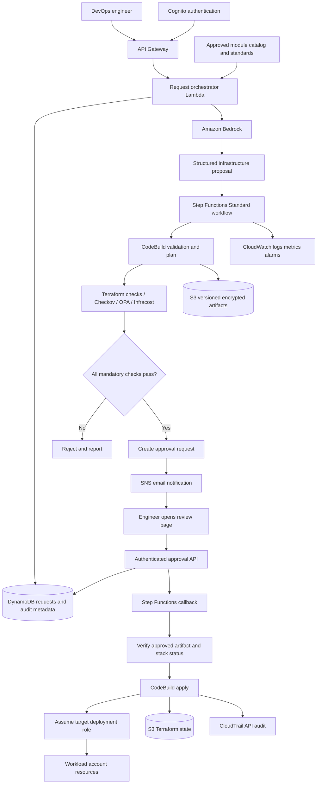

# ai_agent_infra

We are building an AI infrastructure platform for DevOps engineers—not a platform limited to two-tier applications. “Build a two-tier application”

## 1. Confirmed scope and working defaults

| Area | Decision |
| --- | --- |
| Primary user | DevOps engineer |
| Purpose | Translate infrastructure requirements into reviewed, validated Terraform deployments |
| Infrastructure scope | Expandable approved service/module catalog; a two-tier application is the first demonstration |
| Security | Least privilege, private workloads where appropriate, encryption, controlled execution, auditable approvals |
| Approval | SNS email notification linking to an authenticated approval page |
| Changes requiring approval | Create, update, replace, and destroy |
| Budget | $50–$100/month for testing, including temporarily deployed workloads |
| Implementation | Terraform, Python Lambda functions, GitHub Actions, AWS CodeBuild |
| Region | Retain `ap-south-1` from your diagram, subject to selected Bedrock model availability |
| Accounts | Control-plane account and isolated workload account, where available |
| Environments | Separate dev/staging/prod configurations and state; initially deploy dev only |
| Initial usage assumption | One engineer, approximately 5–10 requests/day, short-lived demo deployments |

Enterprise-oriented here means production-style controls and clear failure handling. It does not mean running an expensive, continuously available production workload on a testing budget.

## 2. Project blueprint

### Project: Governed AI Infrastructure Deployment Platform

A DevOps engineer submits an infrastructure requirement. Amazon Bedrock converts it into a structured proposal using approved Terraform modules. A deterministic pipeline validates the proposal, produces a Terraform plan, checks security and policy rules, and estimates cost. The engineer reviews the exact proposed changes through an authenticated approval interface reached from an SNS email. Only the deployment pipeline—not the LLM—can assume the target deployment role and apply the approved plan.

### Functional requirements

- Accept infrastructure requests and return a request ID.
- Identify missing requirements before generating deployable configuration.
- Generate Terraform compositions from an approved module catalog.
- Run syntax, security, policy, plan, and cost checks.
- Present creates, updates, replacements, destroys, policy results, and estimated costs.
- Require an explicit approval decision before execution.
- Return deployment status and sanitized outputs.
- Support rejection, expiration, failure recovery, and approved destruction.
- Retain an attributable audit history.

### Non-functional requirements

- No AWS deployment credentials available to the model.
- Fail closed on failed checks, unavailable mandatory validators, or expired approval.
- One active deployment per stack.
- Traceability from request to generated code, checks, approval, and execution.
- Explicit separation of control-plane resources and managed workloads.
- Bounded retries, model usage, build duration, and artifact retention.
- No claim of compliance certification: policy checks enforce our defined baseline, not an entire regulatory framework.

## 3. Architecture

AWS documents the Step Functions human-approval pattern using API Gateway, Lambda, SNS email, and a paused workflow. We will adapt that pattern so that the approval action requires authentication rather than treating possession of an email link as sufficient authorization.
